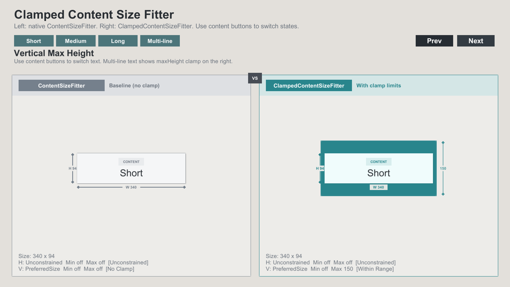
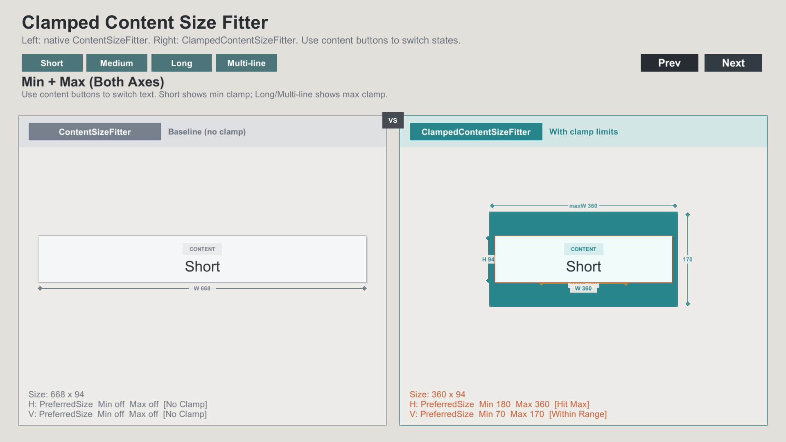

# Samples

Import **ClampedContentSizeFitter Demo** from Unity Package Manager.

## Included

- **ClampedContentSizeFitterDemo.unity** - Multi-page demo scene with Prev/Next switching and manual content buttons (`Short/Medium/Long/Multi-line`). Each page shows native `ContentSizeFitter` (left) vs `ClampedContentSizeFitter` (right):
  - Horizontal Max Width
  - Vertical Max Height
  - Min + Max (Both Axes)
- **ClampedContentSizeFitterDemoController.cs** - Cycles text and updates live size/fit/min/max info.
- **ClampedContentSizeFitterDemoPageController.cs** - Handles page switching and case titles/descriptions.
- **ClampedContentSizeFitterDemo.cs** - Minimal code example.

### Horizontal Max

### Vertical Max

### Min + Max

