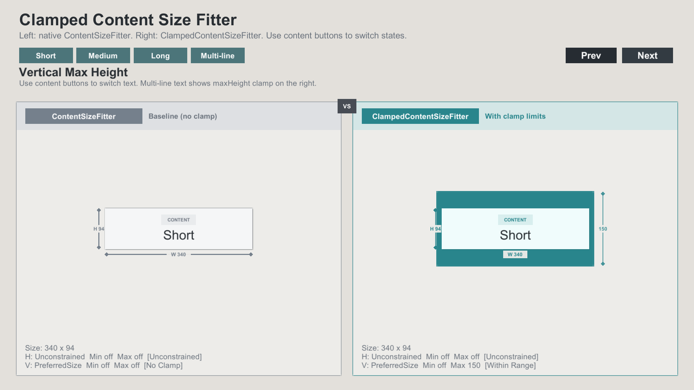
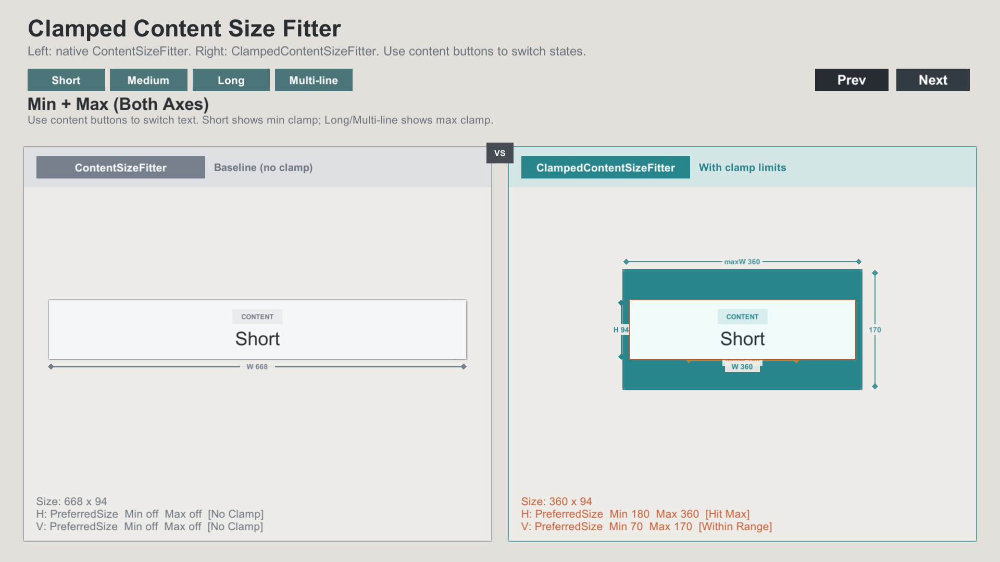

# 示例

在 Unity Package Manager 中导入 **ClampedContentSizeFitter Demo**。

## 包含内容

- **ClampedContentSizeFitterDemo.unity** - 多页 demo 场景，支持 Prev/Next 切换和内容按钮（`Short/Medium/Long/Multi-line`）；每页左侧为原生 `ContentSizeFitter`，右侧为 `ClampedContentSizeFitter`：
  - Horizontal Max Width
  - Vertical Max Height
  - Min + Max (Both Axes)
- **ClampedContentSizeFitterDemoController.cs** - 循环文本并实时更新 size/fit/min/max 信息。
- **ClampedContentSizeFitterDemoPageController.cs** - 处理页面切换和案例标题/说明。
- **ClampedContentSizeFitterDemo.cs** - 最小代码示例。

### Horizontal Max

### Vertical Max

### Min + Max

