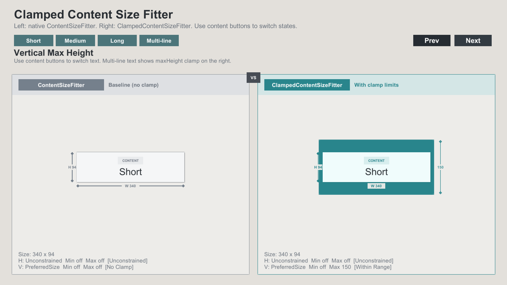
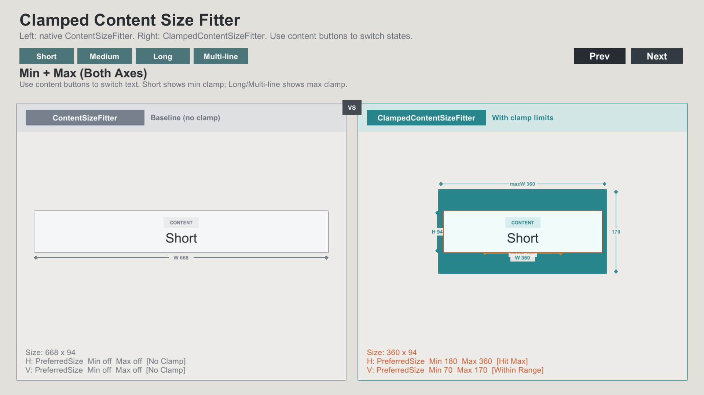

# MUD Clamped Content Size Fitter

**English** | [简体中文](README.zh-CN.md)

`ClampedContentSizeFitter` extends Unity UI's `ContentSizeFitter` with optional min/max width and height clamping. It keeps the familiar ContentSizeFitter workflow while preventing content-driven layouts from becoming too small or too large.

[](https://unity.com/)
[](LICENSE)
[](https://github.com/MUDV587/com.mud.modules.clampedcontentsizefitter)

### Horizontal Max


### Vertical Max



### Min + Max



## Features

- **ContentSizeFitter-compatible** - Inherits from `UnityEngine.UI.ContentSizeFitter`, so fit modes and layout behavior stay familiar.
- **Optional clamps per axis** - Configure `Min Width`, `Max Width`, `Min Height`, and `Max Height` independently.
- **Axis-aware behavior** - Clamps are applied only when the corresponding fit mode is not `Unconstrained`.
- **Inspector-friendly** - Custom editor shows clamp fields only for fitted axes, with enable toggles.
- **Playable comparison sample** - Multi-page demo scene with side-by-side comparison, visible min/max range frames, and live hit-status feedback.

## Requirements

- Unity **2022.3 LTS** or newer.
- `com.unity.ugui` 1.0.0+.

## Installation

### Package Manager

1. Open **Window > Package Manager**.
2. Click **+** in the top-left corner.
3. Choose **Add package from git URL...**.
4. Enter:

```text
https://github.com/MUDV587/com.mud.modules.clampedcontentsizefitter.git#v0.1.0
```

5. Click **Add**.

### manifest.json

Add this entry to `Packages/manifest.json`:

```json
"com.mud.modules.clampedcontentsizefitter": "https://github.com/MUDV587/com.mud.modules.clampedcontentsizefitter.git#v0.1.0"
```

## Quick Start

1. Add `ClampedContentSizeFitter` to a `RectTransform` (instead of `ContentSizeFitter`).
2. Set **Horizontal Fit** / **Vertical Fit** as you normally would.
3. Enable the clamp fields you need and set min/max values.
4. The fitted axis size is calculated by ContentSizeFitter, then clamped to the configured range.

> A value of `-1` means the limit is disabled.

## Behavior Notes

- Clamping runs after the base `ContentSizeFitter` layout calculation in `SetLayoutHorizontal()` / `SetLayoutVertical()`.
- When both min and max are enabled and `min > max`, the range is normalized consistently (`max = min`).
- `Unconstrained` axes are not modified.
- The component includes `[ExecuteAlways]` and an `AddComponentMenu` entry under **Layout/Clamped Content Size Fitter**.

## Samples

Import **ClampedContentSizeFitter Demo** from Package Manager. The sample includes:

- `ClampedContentSizeFitterDemo.unity` - Multi-page demo scene with Prev/Next switching and manual content buttons (`Short/Medium/Long/Multi-line`). Each page shows a side-by-side comparison: native `ContentSizeFitter` vs `ClampedContentSizeFitter`.
- `ClampedContentSizeFitterDemoController.cs` - Drives one comparison area: cycles text and updates live size/fit/min/max info.
- `ClampedContentSizeFitterDemoPageController.cs` - Handles page switching and case titles/descriptions.
- `ClampedContentSizeFitterDemo.cs` - Minimal script example for configuring clamp values.

## Documentation

- **English documentation**: https://mudv587.github.io/com.mud.modules.clampedcontentsizefitter/
- **中文文档**: https://mudv587.github.io/com.mud.modules.clampedcontentsizefitter/zh/
- **Changelog**: [CHANGELOG.md](CHANGELOG.md)

## License

MIT. See [LICENSE](LICENSE).
