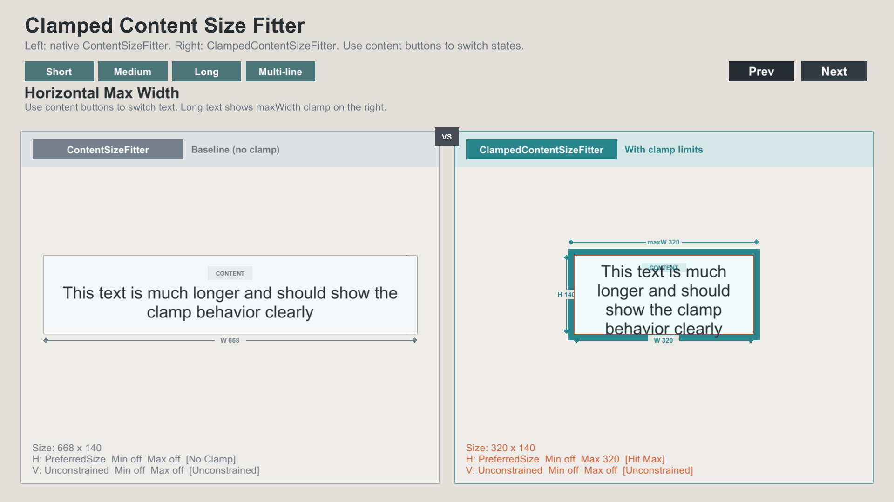
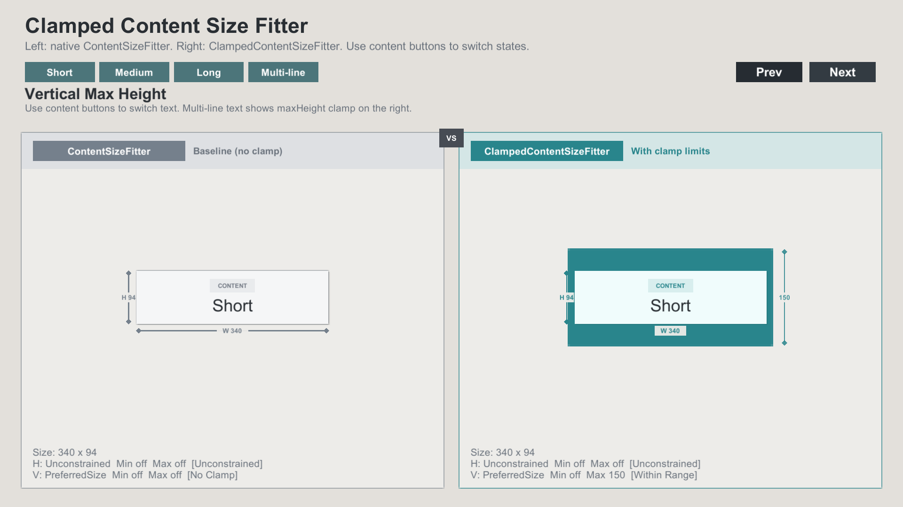
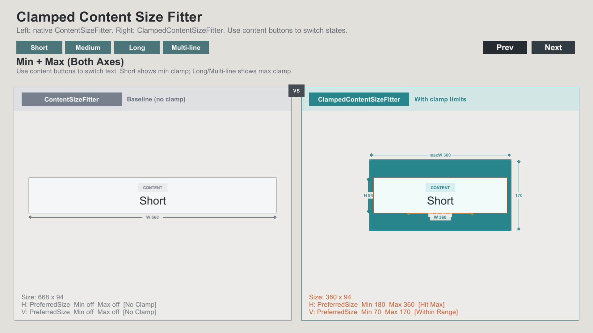

# MUD Clamped Content Size Fitter

[English](README.md) | **简体中文**

`ClampedContentSizeFitter` 在 Unity UI 的 `ContentSizeFitter` 基础上增加了可选的最小/最大宽高限制。在保持原有 Fit 工作流的同时，避免内容驱动布局过小或过大。

[](https://unity.com/)
[](LICENSE)
[](https://github.com/MUDV587/com.mud.modules.clampedcontentsizefitter)

### Horizontal Max



### Vertical Max



### Min + Max



## 功能

- **兼容 ContentSizeFitter** - 继承自 `UnityEngine.UI.ContentSizeFitter`，Fit 模式和布局行为保持熟悉。
- **按轴可选 Clamp** - 可独立配置 `Min Width`、`Max Width`、`Min Height`、`Max Height`。
- **只作用于受控轴** - 仅当对应轴 Fit 模式不是 `Unconstrained` 时才应用 clamp。
- **Inspector 友好** - 自定义编辑器只显示受控轴的 clamp 字段，并提供启用开关。
- **可播放对比 Sample** - 多页左右对比场景，带可见 min/max 范围框和实时命中状态反馈。

## 环境要求

- Unity **2022.3 LTS** 或更高版本。
- `com.unity.ugui` 1.0.0+。

## 安装

### Package Manager

1. 打开 **Window > Package Manager**。
2. 点击左上角 **+**。
3. 选择 **Add package from git URL...**。
4. 输入：

```text
https://github.com/MUDV587/com.mud.modules.clampedcontentsizefitter.git#v0.1.0
```

5. 点击 **Add**。

### manifest.json

在 `Packages/manifest.json` 中添加：

```json
"com.mud.modules.clampedcontentsizefitter": "https://github.com/MUDV587/com.mud.modules.clampedcontentsizefitter.git#v0.1.0"
```

## 快速开始

1. 在 `RectTransform` 上添加 `ClampedContentSizeFitter`（替代 `ContentSizeFitter`）。
2. 像平常一样设置 **Horizontal Fit** / **Vertical Fit**。
3. 启用需要的 clamp 字段并设置 min/max。
4. 组件会先按 ContentSizeFitter 计算尺寸，再将受控轴夹取到配置范围内。

> `-1` 表示该限制未启用。

## 行为说明

- Clamp 在基类 `SetLayoutHorizontal()` / `SetLayoutVertical()` 计算完成后执行。
- 当 min/max 同时启用且 `min > max` 时，会统一归一化为 `max = min`。
- `Unconstrained` 轴不会被修改。
- 组件包含 `[ExecuteAlways]`，并在 **Layout/Clamped Content Size Fitter** 菜单中可添加。

## Samples

在 Package Manager 中导入 **ClampedContentSizeFitter Demo**。示例包含：

- `ClampedContentSizeFitterDemo.unity` - 多页 demo 场景，支持 Prev/Next 切换和内容按钮（`Short/Medium/Long/Multi-line`）；每页左右对比原生 `ContentSizeFitter` 与 `ClampedContentSizeFitter`。
- `ClampedContentSizeFitterDemoController.cs` - 驱动单个对比区域：循环文本并实时显示 size/fit/min/max 信息。
- `ClampedContentSizeFitterDemoPageController.cs` - 处理页面切换和案例标题/说明。
- `ClampedContentSizeFitterDemo.cs` - 配置 clamp 值的最小脚本示例。

## 文档

- **English documentation**: https://mudv587.github.io/com.mud.modules.clampedcontentsizefitter/
- **中文文档**: https://mudv587.github.io/com.mud.modules.clampedcontentsizefitter/zh/
- **变更日志**: [CHANGELOG.md](CHANGELOG.md)

## 许可证

MIT，见 [LICENSE](LICENSE)。
